# 🪨 Rockfall Detection — 道路落石与滑坡 YOLO11 检测全流程

<p align="center">
  <b>从数据构建、训练、逐 step 监控到论文级可视化的完整可复现实验流水线</b><br/>
  <sub>Road rockfall &amp; landslide detection with YOLO11 · Training · Evaluation · Visualization</sub>
</p>

<p align="center">
  
  
  
  
  
  
</p>

---

## 📖 项目简介

本项目针对**山区公路落石（rockfall）与滑坡（landslides）**场景，基于 **YOLO11n** 构建了一套面向科研论文的目标检测实验流水线。除了常规的「训练 → 验证 → 出图」，本项目在训练过程中通过 Ultralytics 回调**逐 step 采集损失、梯度 L2 范数与逐层梯度流、学习率、每 epoch 耗时**，从而可以在论文中呈现完整的优化动态，而不只是最终的 mAP 数字。

仓库内含**完整数据集（1964 张图像 + YOLO 标签）**、训练好的权重、全部实验图表、可复现的 Jupyter Notebook 以及 30 页 PDF 实验报告，克隆即可复现全部结果。

### ✨ 亮点

- **端到端流水线**：`rockfall.ndjson` → 图像下载 → YOLO 标签/`data.yaml` → 训练 → 评价 → 论文图表，一键跑通且幂等。
- **训练过程可观测**：逐 step 总损失与分解损失（box/cls/dfl）、全局与逐层梯度范数、warm-up + 余弦学习率、每轮耗时。
- **论文级图表**：15+ 张高分辨率 PNG（最高 4800×1920）与配套 CSV / JSON 指标，直接可排版。
- **完整可复现**：固定随机种子（42）、`deterministic=True`、全部超参数集中在 `CFG` 字典并随工件保存（`args.yaml` / `metrics_full.json`）。
- **附带数据集与权重**：`datasets/` 与 `runs/yolo11n_rockfall/weights/best.pt` 均已入库，无需重新下载即可评价或推理。

---

## 🖼️ 效果预览

<p align="center">
  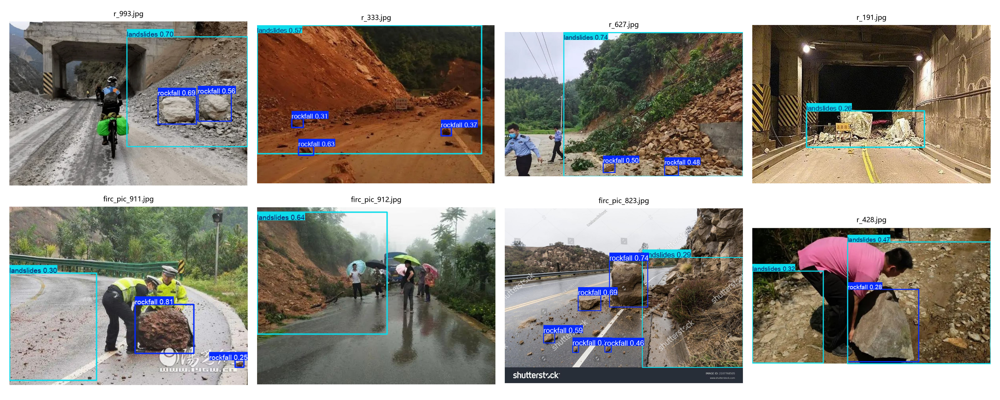<br/>
  <sub><b>检测结果画廊</b>：测试集随机 8 幅图像，绿色为真实标注、红色为模型预测（conf ≥ 0.25）</sub>
</p>

<table>
<tr>
<td width="50%">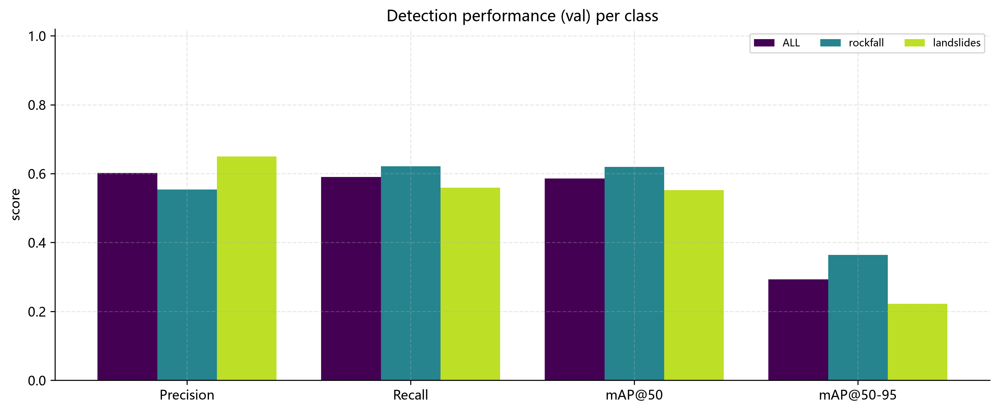<br/><sub><b>总体与逐类指标</b>（P / R / mAP@50 / mAP@50-95）</sub></td>
<td width="50%">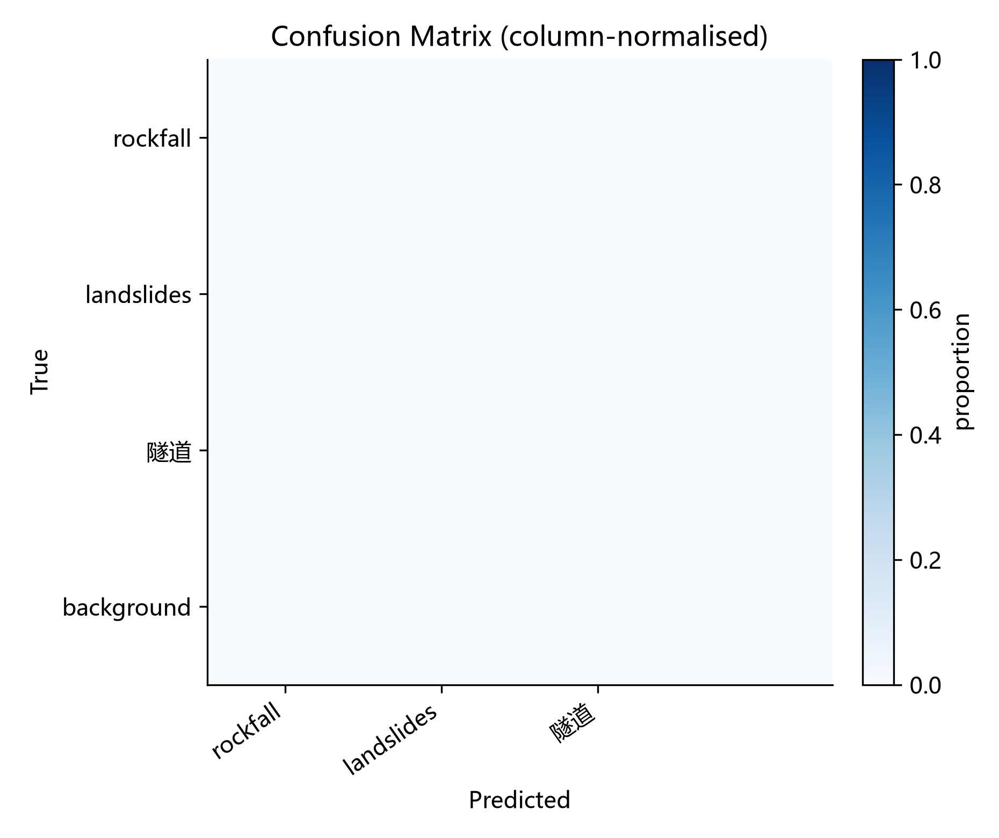<br/><sub><b>混淆矩阵</b>（列归一化，测试集）</sub></td>
</tr>
</table>

---

## 📊 主要结果

在 `best.pt`（第 46 轮）上重新评估，**边界框（B）**指标如下：

| 划分 | Precision | Recall | F1 | mAP@50 | mAP@50-95 |
|:---|:---:|:---:|:---:|:---:|:---:|
| **val**（390 张） | 0.602 | 0.590 | 0.593 | **0.586** | **0.293** |
| **test**（258 张） | 0.662 | 0.550 | 0.597 | **0.605** | **0.301** |

逐类表现（`AP` 为 mAP@50-95）：

| 类别 | val P | val R | val AP@50 | val AP | test P | test R | test AP@50 | test AP |
|:---|:---:|:---:|:---:|:---:|:---:|:---:|:---:|:---:|
| `rockfall` 落石 | 0.554 | 0.621 | 0.619 | 0.364 | 0.581 | 0.566 | 0.606 | 0.356 |
| `landslides` 滑坡 | 0.649 | 0.559 | 0.553 | 0.222 | 0.743 | 0.534 | 0.604 | 0.246 |

> 指标原始数据见 [`figs/metrics_full.json`](figs/metrics_full.json)、[`figs/metrics_test.csv`](figs/metrics_test.csv)、[`figs/metrics_val.csv`](figs/metrics_val.csv)。

---

## 📁 数据集

**来源**：[Ultralytics Platform · `vic-vulture/rockfall`](https://platform.ultralytics.com/vic-vulture/datasets/rockfall) — *"Street-level and aerial images of rockfall and landslide events on roads, annotated for object detection to identify debris, boulders, and terrain instability."*

仓库内的 [`rockfall.ndjson`](rockfall.ndjson) 是数据集的完整清单（每行一个 JSON：第 1 行为元信息，其余为图像 URL 与归一化 `[cls, cx, cy, w, h]` 标注），`rockfall_dataset.py` 可据此重建整个 `datasets/` 目录。

| 划分 | 图像数 | 标注框数 |
|:---|:---:|:---:|
| train | 1316 | 3712 |
| val | 390 | 814 |
| test | 258 | 710 |
| **合计** | **1964** | **5236** |

**类别分布**：

| ID | 类别 | train | val | test | 合计 |
|:---:|:---|:---:|:---:|:---:|:---:|
| 0 | `rockfall` 落石 | 2675 | 476 | 488 | 3639 |
| 1 | `landslides` 滑坡 | 1031 | 338 | 222 | 1591 |
| 2 | `隧道` tunnel | 6 | 0 | 0 | 6 |

<p align="center">
  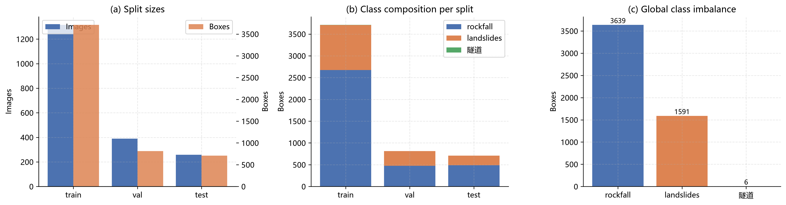<br/>
  <sub><b>EDA</b>：(a) 各划分的图像/标注规模　(b) 类别构成　(c) 全局类别不平衡</sub>
</p>

<table>
<tr>
<td width="48%">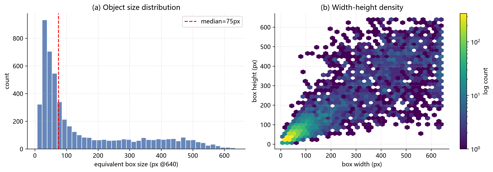<br/><sub><b>目标框尺寸分布</b>（按 imgsz=640 换算，等效边长）</sub></td>
<td width="52%">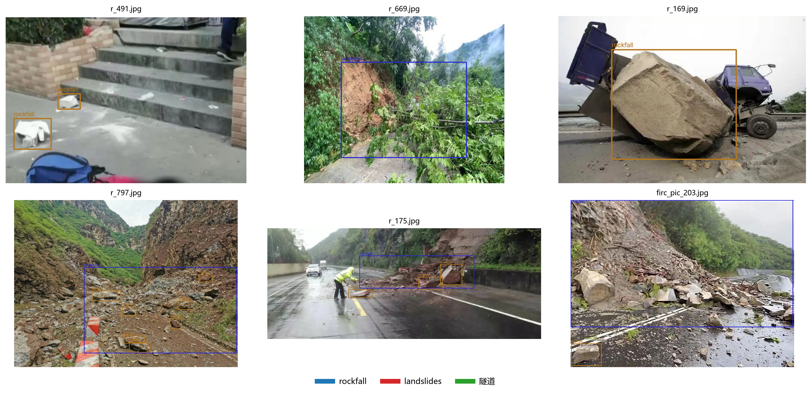<br/><sub><b>训练集标注样例</b>（随机 6 幅）</sub></td>
</tr>
</table>

> 📌 **类别极度不平衡**：`隧道` 仅 6 个标注且只出现在训练集，验证/测试集中不存在；因此有效评估类别为 `rockfall` 与 `landslides` 两类。这一现象本身也是论文中值得讨论的数据集特征。

---

## 🧪 训练配置

| 项目 | 设置 |
|:---|:---|
| 模型 | `yolo11n.pt`（2.62 M 参数，迁移学习） |
| 硬件 | NVIDIA T1200 Laptop GPU，4 GB 显存 |
| 输入尺寸 / Batch | 640 × 640 / 8 |
| Epochs | 60（`patience=20` 早停） |
| 优化器 | `auto`（Ultralytics 自适应选择） |
| 学习率 | `lr0=0.01`，`lrf=0.01`，`warmup_epochs=3.0` |
| 正则 | `momentum=0.937`，`weight_decay=5e-4` |
| 数据增强 | HSV(h .015 / s .7 / v .4)、旋转 ±10°、平移 .1、缩放 .5、剪切 2°、水平翻转 .5、Mosaic 1.0、最后 10 轮关闭 Mosaic |
| 复现性 | `seed=42`，`deterministic=True` |
| 训练耗时 | 约 **55 分钟**（3296 s @ 60 epochs） |
| 最佳轮次 | epoch 46（mAP@50-95 = 0.295） |

全部超参数与运行环境已固化在 [`runs/yolo11n_rockfall/args.yaml`](runs/yolo11n_rockfall/args.yaml) 与 [`figs/metrics_full.json`](figs/metrics_full.json)。

---

## 📈 训练动态

训练回调逐 step / 逐 epoch 采集优化过程数据，可直接用于论文的 *Training Dynamics* 小节。

<table>
<tr>
<td width="50%">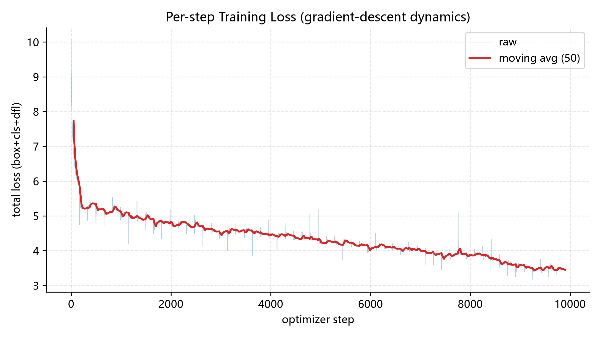<br/><sub><b>图 5.1</b> 逐 step 总损失（含滑动平均）——收敛动态</sub></td>
<td width="50%">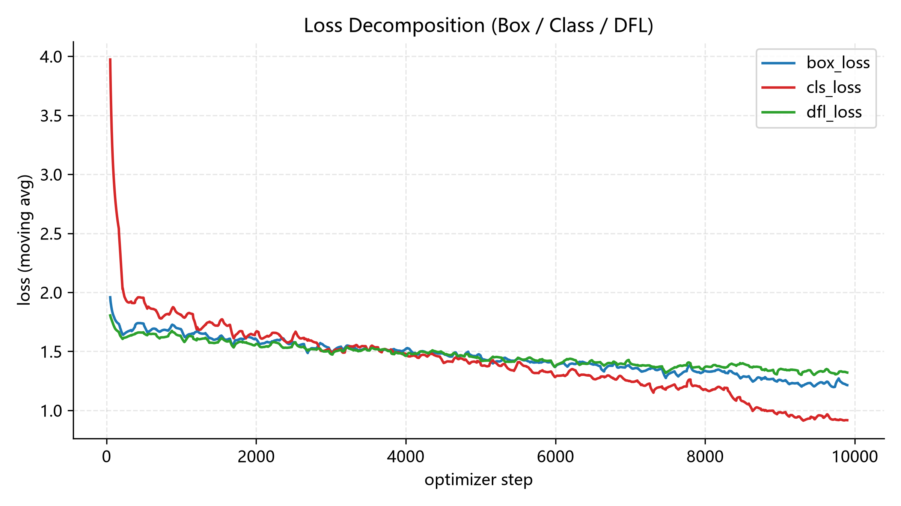<br/><sub><b>图 5.2</b> 损失分解（box / cls / dfl）</sub></td>
</tr>
<tr>
<td>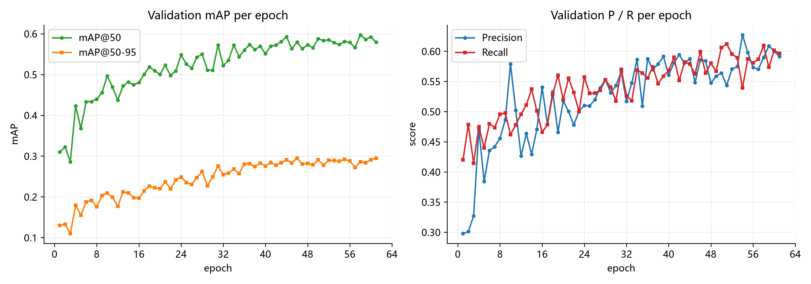<br/><sub><b>图 5.3</b> 逐 epoch 验证 mAP 与 P/R</sub></td>
<td>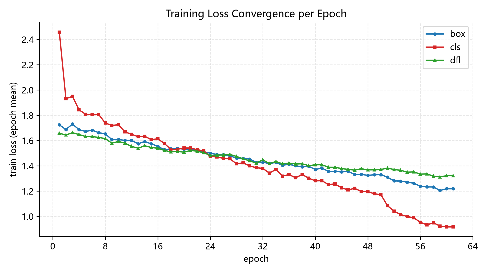<br/><sub><b>图 5.4</b> 逐 epoch 训练损失</sub></td>
</tr>
<tr>
<td>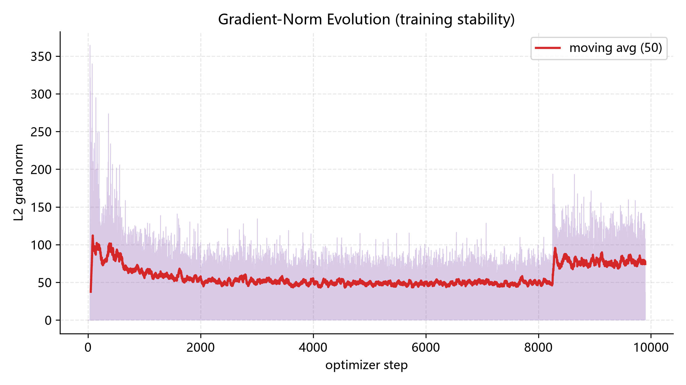<br/><sub><b>图 5.5</b> 梯度 L2 范数演化（训练稳定性）</sub></td>
<td>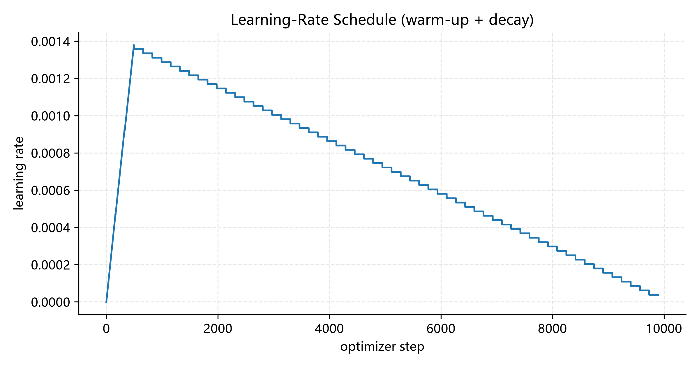<br/><sub><b>图 5.6</b> 学习率调度（warm-up + 余弦退火）</sub></td>
</tr>
<tr>
<td>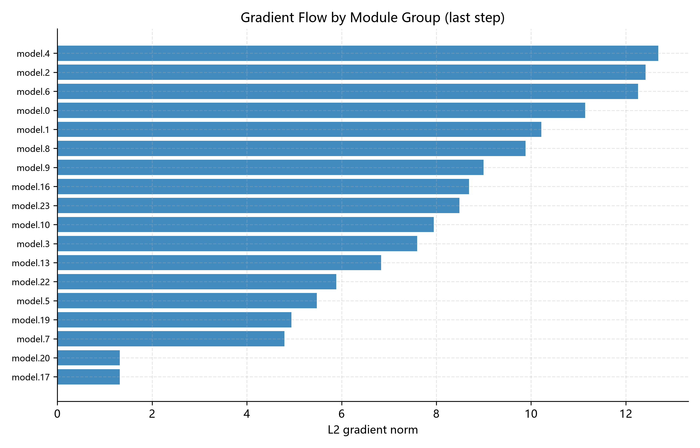<br/><sub><b>图 5.7</b> 逐层梯度流（按模块分组）</sub></td>
<td>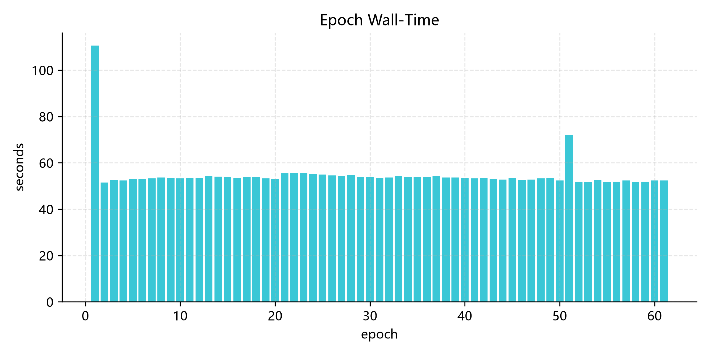<br/><sub><b>图 5.8</b> 每轮训练耗时</sub></td>
</tr>
</table>

<details>
<summary><b>Ultralytics 原生训练结果（results.png / 损失与指标汇总）</b></summary>
<p align="center">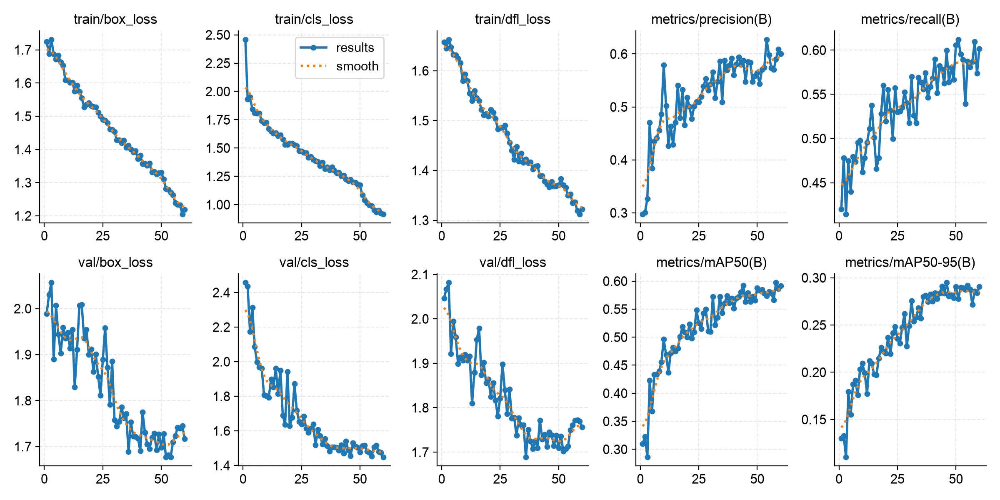</p>
</details>

---

## 🎯 模型评价

<table>
<tr>
<td width="50%">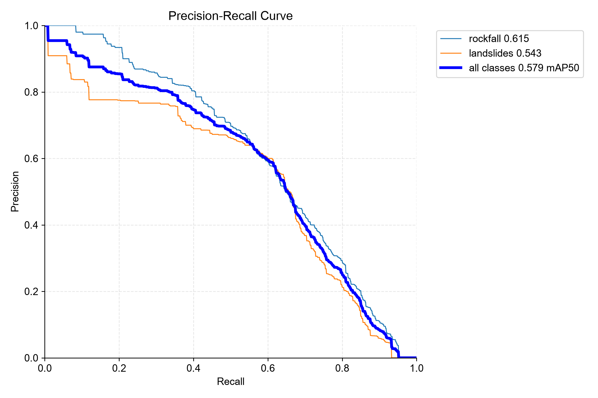<br/><sub><b>Precision–Recall 曲线</b>（验证集）</sub></td>
<td width="50%">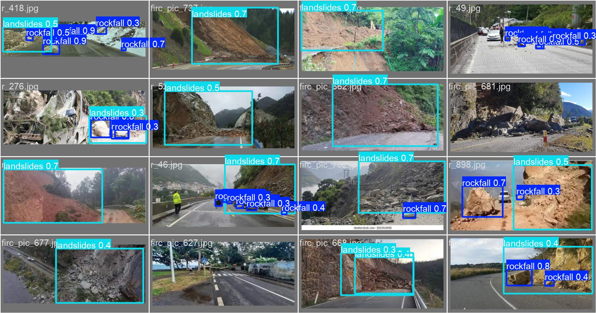<br/><sub><b>验证集批量预测</b>（val_batch0）</sub></td>
</tr>
</table>

<details>
<summary><b>更多验证图</b>（P/F1 曲线、训练批次、混淆矩阵等）</summary>

| 图 | 说明 |
|:---|:---|
| [`runs/yolo11n_rockfall/BoxP_curve.png`](runs/yolo11n_rockfall/BoxP_curve.png) | Precision–Confidence 曲线 |
| [`runs/yolo11n_rockfall/BoxF1_curve.png`](runs/yolo11n_rockfall/BoxF1_curve.png) | F1–Confidence 曲线 |
| [`runs/yolo11n_rockfall/confusion_matrix.png`](runs/yolo11n_rockfall/confusion_matrix.png) | Ultralytics 混淆矩阵 |
| [`runs/yolo11n_rockfall/train_batch0.jpg`](runs/yolo11n_rockfall/train_batch0.jpg) | 训练批次（含数据增强） |
| [`runs/yolo11n_rockfall/labels.jpg`](runs/yolo11n_rockfall/labels.jpg) | 标注分布总览 |
| [`runs/detect/val*/`](runs/detect) | 多轮验证的 PR / F1 / 混淆矩阵 / 批量预测 |

</details>

---

## 🗂️ 仓库结构

```text
rockfall/
├── rock_fall_001.ipynb          # ⭐ 主 Notebook：7 章完整实验流水线（含全部输出）
├── rock_fall_001.pdf            # 30 页 PDF 报告（Notebook 导出）
├── rockfall_dataset.py          # 数据构建：ndjson 解析 / 下载 / 标签与 data.yaml 生成
├── rockfall_training.py         # 训练回调、评价、全部可视化函数
├── rockfall.ndjson              # 数据集清单（URL + 归一化标注）
├── yolo11n.pt                   # YOLO11n 预训练权重（迁移学习起点）
├── requirements.txt
├── LICENSE
│
├── datasets/rockfall/           # 完整数据集（1964 图 + 1964 标签）
│   ├── data.yaml
│   ├── dataset_stats.json
│   ├── images/{train,val,test}/
│   └── labels/{train,val,test}/
│
├── runs/
│   ├── yolo11n_rockfall/        # 训练产物：best.pt / last.pt / results.csv / 曲线
│   └── detect/val*/             # 多次验证的可视化输出
│
├── figs/                        # 论文级图表 + 指标 CSV/JSON
└── ultralytics_cfg/             # Ultralytics 运行配置（runs/ 重定向用）
```

---

## 🚀 快速开始

### 1. 环境安装

```bash
git clone https://github.com/lizhengyang-byte/rockfall-detection.git
cd rockfall-detection
pip install -r requirements.txt
```

> 需要 CUDA 版 PyTorch 才能用 GPU 训练；CPU 也能运行，但训练会很慢。项目在 `torch 2.6.0+cu124` + `ultralytics 8.4.202` 下验证通过。
>
> ⚠️ 所有命令请在**仓库根目录**执行：`datasets/rockfall/data.yaml` 中的 `path: datasets/rockfall` 是相对路径，依赖当前工作目录来解析。

### 2. 直接使用（权重与数据已入库）

```python
from ultralytics import YOLO

model = YOLO("runs/yolo11n_rockfall/weights/best.pt")
results = model.predict("datasets/rockfall/images/test", conf=0.25, save=True)
```

### 3. 复现完整实验

```bash
jupyter lab rock_fall_001.ipynb
```

Notebook 按 7 个章节组织，依次运行即可（数据集已存在时会自动跳过下载）：

| 章节 | 内容 |
|:---:|:---|
| 1 | 环境与可复现性（随机种子 / GPU / 版本） |
| 2 | 从 `rockfall.ndjson` 构建 YOLO 数据集 |
| 3 | 探索性数据分析：划分、类别不平衡、尺寸分布、标注可视化 |
| 4 | YOLO11n 迁移学习训练 + 逐 step / 逐 epoch 回调采集 |
| 5 | 训练过程可视化（损失、梯度、学习率、耗时） |
| 6 | 模型评价（P/R/F1/mAP、混淆矩阵、PR/F1 曲线、检测画廊） |
| 7 | 结果汇总与论文图表清单 |

从零重建数据集（可选）：

```python
from rockfall_dataset import build_dataset
build_dataset("rockfall.ndjson", "datasets/rockfall", workers=16)
```

---

## 🔬 可复现性说明

- 随机种子统一为 `42`（`random` / `numpy` / `torch`），并开启 `cudnn.deterministic`、关闭 `benchmark`。
- 所有超参数集中在 Notebook 的 `CFG` 字典中，并随训练写入 `args.yaml`。
- 评价结果同时落盘为 JSON 与 CSV（`figs/metrics_*.json|csv`），便于论文制表。
- 本机为 4 GB 显存的笔记本 GPU；若显存不足，把 `BATCH` 降到 4 或 2，或把 `EPOCHS` 降到 5–10 先跑通流程。

---

## ⚠️ 局限性与讨论

1. **mAP@50-95 偏低（约 0.30）**：道路场景中落石/滑坡目标尺度差异大、边界模糊，且小目标占比高；可尝试更大模型（`yolo11s/m`）、更高输入分辨率或切片推理（SAHI）。
2. **类别极度不平衡**：`隧道` 类别仅 6 个标注且只存在于训练集，模型无法可靠检测该类；建议补充数据或从任务中移除该类。
3. **域偏移**：数据以街景与航拍道路图像为主，迁移到其他地质/光照条件时需重新验证。
4. **数据授权**：数据集来自 Ultralytics 平台的第三方发布者，本仓库为科研复现目的附带，权利归原作者所有（详见下方许可说明）。

---

## 📄 许可与引用

**代码**：[MIT License](LICENSE) — 可自由使用、修改与分发，请保留版权声明。

**数据集**：`datasets/` 内容来自 [Ultralytics Platform `vic-vulture/rockfall`](https://platform.ultralytics.com/vic-vulture/datasets/rockfall)，版权归原始发布者所有。本项目仅出于学术研究与结果复现目的随仓库提供，**不主张任何权利，也不构成再授权**。如原作者或平台认为不妥，请开 Issue 联系，我们将立即移除。

**模型**：`yolo11n.pt` 为 [Ultralytics YOLO11](https://github.com/ultralytics/ultralytics) 官方预训练权重，遵循 AGPL-3.0。

如果本项目对你的研究有帮助，欢迎 Star ⭐：

```bibtex
@misc{rockfall-detection-yolo11,
  title  = {Rockfall Detection: A Reproducible YOLO11 Pipeline for Road Rockfall and Landslide Detection},
  author = {lizhengyang-byte},
  year   = {2026},
  url    = {https://github.com/lizhengyang-byte/rockfall-detection}
}
```
